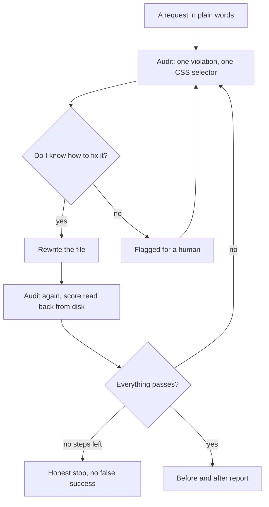

**English** · [Français](README.md)

# RGAA Agent

An agent that repairs accessibility. It opens a page, finds what gets in the way, writes the fix, checks again, and repeats. At the end it shows two states of the same site, with the numbers that go with them.

[](../../actions/workflows/ci.yml)


[Start](#what-it-gives-right-away) · [How it works](#how-it-works) · [What it cannot do](#what-it-cannot-do) · [Deployment](docs/DEPLOY.md)

## What I wanted to do

I came across a real audit report, with thirty-four numbered failures. Very well made. Nobody ever opened it again after the meeting where it was presented.

The diagnosis was not the problem. The problem is what comes after: open each file, find the tag, choose a value, and check that nothing broke three lines below. That work takes weeks and nobody does it, because it is invisible and it fits in no schedule.

So I wrote the agent that does it. Not the one that gives advice: the one that fixes, checks, and owns what it could not fix.

## What it gives, right away

```bash
python -m rgaa demo --open        # two states of the site, numbers ready, and a button to run it again
python -m rgaa run conformite     # the agent fixes, then reports
python -m rgaa coverage           # the 106 RGAA criteria, one by one
```

On a four-page demo site: **70.8 % before, 100 % after**, 48 checks out of 48, 16 fixes really written into the files, zero errors, in 0.45 second. No GPU, no model, no network, no account.

## Run it in Docker

```bash
docker run --rm -p 8080:8080 -p 8090:8090 -v rgaa-data:/var/lib/rgaa ghcr.io/loelie890/rgaa-agent:latest
```

The interface is on `http://localhost:8080`, the demo on `/demo` and on `http://localhost:8090`. The image is about 330 MB, Chromium and Xvfb are already inside, so the rendered pass works without installing anything. A second image, `:ollama`, adds the engine for the offline demo and is about 2.2 GB.

## How it works



Three rules I set for myself, and they are tested. A patch that changes nothing is refused, otherwise the agent could congratulate itself on an empty result. A path outside the analysed folder is an error, not a warning. And a fix I cannot guess, like describing a photo, is never invented: it is written as a draft and flagged.

## One example, the one that convinced me

The pricing page has a light grey note under each column. By eye, it looks fine. Its real contrast is 2.34:1, and the minimum is 4.5:1.

A classic tool writes "insufficient contrast, criterion 3.2" and stops there. Mine reads the style block, applies the cascade, finds the rule giving `#a3aab3` to the text, computes the ratio, looks for the closest compliant shade that keeps the hue, and writes `#72777d` at 4.52:1. Then it reads the score again. The page goes from 91.7 % to 100 %.

Three lines changed, nobody opened an editor.

## What it fixes alone, what it does not touch

It fixes without asking: a missing image alternative, a link name, a role, a page language, a heading level, a field label, a colour that is too light.

It does not touch content. Describing an image or naming a button requires understanding what the page says, and that is not its job. So it proposes a draft from context, a title, a file name, an existing label, and flags it. On the demo, five fixes out of sixteen are in that case, and the report says so next to the score.

## Three ways to look at a page

**The file**, first. Twelve mechanical rules read from the HTML, one selector per faulty element, a score recomputed after each write. This pass is enough to do everything, and it runs without installing anything.

**The page**, next. It is opened in Chromium, headless or with a window, and a probe measures what the file cannot say: contrast computed on the real style, names as the browser understands them, what JavaScript adds, what it hides. Chromium is optional, and its absence is announced rather than suffered.

**The image**, last. Three questions escape every rule: is the image decorative or informative, does its alternative describe what is visible, does it carry text. A local model answers. And if it answers badly, I do not publish its answer: I tested with a small model, four images, 42 seconds, zero alternatives written because it described shapes in English. The guard chose silence over a wrong sentence.

## The table I did not hide

```
106 RGAA 4.1 criteria · 29 tooled (12 fixed, 17 detected) · 77 left to a human · 27.4 %
```

The score covers what is measured, and the word "compliant" never appears alone in a report: the sentence next to it always says on what.

## The card I would need

Everything else runs on a plain processor. The only part that needs memory is vision, and the calculation is printed rather than wished for:

```bash
python -m rgaa fit --vram 16
```

On the 4 GB card I have, one model fits, the smallest, and it leaves almost nothing for the browser. On 16 GB, four fit, including a 7B and an 8B: that is the move from a guessed alternative to one that really describes the image.

## Working in a team, and learning

The work splits into sub-agents, one per page or one per area, each with its role and budget. On the demo, four agents in parallel, 16 fixes, 23 milliseconds.

There is also a learning campaign, which I like because it shows failure before success. First pass: seven steps and one error, the agent tries an empty fix, the tool refuses it, and it writes the lesson to disk. Second pass: five steps, zero errors, the lesson is read back and applied. It is not model training, it is a notebook, and I say it that way.

## In a pipeline, and in an MCP client

```bash
python -m rgaa ci fixtures/site --min-score 100 --diff rgaa.patch.diff --report report.html
# 0 when the threshold is met, 1 otherwise
```

Mechanical fixes, a second audit until stable, a diff applicable with `git apply`, a readable report. An already clean page is never rewritten. The same tools exist over MCP, on stdin and stdout, for a client like Claude Desktop: five tools, three methods, no open port.

## What it cannot do

It will not make a site compliant with the 106 criteria, and no tool will without a human. It does not rewrite content. It does not judge a render without a browser. It does not leave the folder it is given. And it does not decide in place of a reviewer when the decision is about meaning.

What it does, it proves: every fix is followed by an audit, every score comes from disk, and every number on this page comes from a command run on this repository.

## Check it without trusting me

```bash
python -m unittest discover -s tests   # 95 tests, 8 s
python -m rgaa validate                # 6 audit decisions, signatures checked
python -m rgaa run conformite          # 24 steps, 0 errors, 48 out of 48
python -m rgaa coverage --json         # the 106-criteria table
python -m rgaa fit --vram 16           # memory sizing, offline
```

Chrome is not installed on my development machine, so the browser chain is verified against a stub binary that mimics its headless mode, and the test says so on its first line. A deployed instance answers `/api/capabilities` with exactly what it can do.

## Licence

MIT, see [LICENSE](LICENSE).
