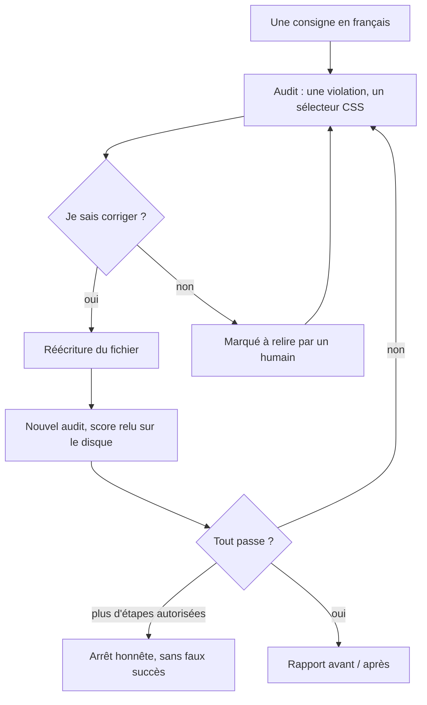

**Français** · [English](README.en.md)

# RGAA Agent

Un agent qui répare l'accessibilité. Il ouvre une page, trouve ce qui gêne, écrit la correction, revérifie, et recommence. À la fin il montre deux états du même site, avec les chiffres qui vont avec.

[](../../actions/workflows/ci.yml)


[Démarrer](#ce-que-ça-donne-tout-de-suite) · [Comment il travaille](#comment-il-travaille) · [Ce qu'il ne sait pas faire](#ce-quil-ne-sait-pas-faire) · [Déploiement](docs/DEPLOY.md)

## Ce que j'ai voulu faire

Je suis tombée sur un rapport d'audit, un vrai, avec trente-quatre non-conformités numérotées. Très bien fait. Personne ne l'a jamais ouvert en dehors de la réunion où on l'a présenté.

Le problème n'était pas le diagnostic. Le problème, c'est qu'après il faut ouvrir chaque fichier, trouver la balise, choisir une valeur, et vérifier qu'on n'a rien cassé trois lignes plus bas. Ce travail-là prend des semaines et personne ne le fait, parce qu'il est invisible et qu'il ne rentre dans aucun planning.

Alors j'ai écrit l'agent qui le fait. Pas celui qui conseille : celui qui corrige, qui vérifie, et qui assume ce qu'il n'a pas su corriger.

## Ce que ça donne, tout de suite

```bash
python -m rgaa demo --open        # deux états du site, chiffres prêts, et un bouton pour relancer
python -m rgaa run conformite     # l'agent corrige, puis rend son rapport
python -m rgaa coverage           # les 106 critères du RGAA, un par un
```

Sur un site de démonstration de quatre pages : **70,8 % avant, 100 % après**, 48 contrôles sur 48, 16 corrections réellement écrites dans les fichiers, zéro erreur, en 0,45 seconde. Sans GPU, sans modèle, sans réseau, sans compte.

## Lancer dans Docker

```bash
docker run --rm -p 8080:8080 -p 8090:8090 -v rgaa-data:/var/lib/rgaa ghcr.io/loelie890/rgaa-agent:latest
```

L'interface arrive sur `http://localhost:8080`, la démo sur `/demo` et sur `http://localhost:8090`.

Trois images, selon ce que vous voulez faire, et vous ne tirez que celle dont vous avez besoin.

| Image | Contenu | Taille | Pour quoi |
| --- | --- | --- | --- |
| `:latest` | audit statique, démo, API, MCP | environ 45 Mo | l'essentiel, en quelques secondes |
| `:browser` | plus Chromium et Xvfb | environ 330 Mo | le passage rendu réel |
| `:ollama` | plus Ollama | environ 2,2 Go | la démo avec un modèle dedans |

Aucun modèle n'est imposé : `:latest` suffit pour corriger un site, `:browser` ajoute la mesure dans un vrai navigateur, et `:ollama` ne sert qu'à faire tourner un modèle dans le conteneur.

## La démo, en pratique

Trois minutes suffisent pour juger, sans lire le reste.

1. `docker run --rm -p 8080:8080 ghcr.io/loelie890/rgaa-agent:latest`
2. Ouvrir `http://localhost:8080/demo` : la page avant à gauche, la même page corrigée à droite, et les éléments touchés entourés en pointillés roses.
3. Changer d'onglet pour passer d'une page à l'autre. Sous les cadres, la liste exacte des correctifs de la page, avec leur sélecteur.
4. Cliquer sur « Lancer maintenant » : sans modèle, l'audit repart en 38 millisecondes. Avec un endpoint distant, le modèle décrit les images et l'agent écrit les alternatives, en une minute environ.

Les chiffres affichés à l'écran sont ceux du dernier calcul, pas une capture. Et le rapport complet reste accessible sur `/demo/rapport.html`.

## Comment il travaille



Trois règles que je me suis imposées, et qui sont testées. Un patch qui ne change rien est refusé, sinon l'agent pourrait se féliciter d'un résultat vide. Un chemin hors du dossier analysé est une erreur, pas un avertissement. Et une correction que je ne peux pas deviner, comme décrire une photo, n'est jamais inventée : elle est écrite en brouillon et signalée à relire.

## Un exemple, celui qui m'a convaincue

La page des tarifs a une note en gris clair sous chaque colonne. À l'œil, tout va bien. Le contraste réel est de 2,34:1, et le minimum est de 4,5:1.

Un outil classique écrit « contraste insuffisant, critère 3.2 » et s'arrête là. Lui lit le bloc de styles, applique la cascade, trouve la règle qui donne `#a3aab3` au texte, calcule le ratio, cherche la teinte conforme la plus proche en gardant la nuance, et écrit `#72777d` à 4,52:1. Il relit le score. La page passe de 91,7 % à 100 %.

Trois lignes ont changé, personne n'a ouvert un éditeur.

## Ce qu'il corrige tout seul, ce qu'il n'ose pas toucher

Il corrige sans demander : une alternative d'image manquante, un intitulé de lien, un repère de rôle, une langue de page, un niveau de titre, une étiquette de champ, une couleur trop claire.

Il ne touche pas au contenu. Décrire une image ou nommer un bouton demande de comprendre ce que la page raconte, et ce n'est pas son métier. Il propose alors un brouillon à partir du contexte, un titre, un nom de fichier, un libellé existant, et il le signale. Sur la démonstration, cinq corrections sur seize sont dans ce cas, et le rapport le dit à côté du score, pas en bas de page en petits caractères.

## Trois façons de regarder une page

**Le fichier**, d'abord. Douze règles mécaniques lues dans le HTML, un sélecteur par élément fautif, et un score recalculé après chaque écriture. C'est la passe qui suffit à tout faire, et c'est celle qui tourne sans rien installer.

**La page, ensuite.** Elle est ouverte dans Chromium, en mode invisible ou avec une fenêtre, et une sonde mesure ce que le fichier ne dit pas : le contraste calculé sur le style réel, les intitulés tels que le navigateur les comprend, ce que JavaScript ajoute, ce qu'il cache. Chromium n'est pas indispensable, et son absence est annoncée plutôt que subie.

**L'image, enfin.** Trois questions échappent à toute règle : l'image est-elle décorative ou porteuse d'information, son alternative décrit-elle vraiment ce qu'on voit, et contient-elle du texte. Un modèle local y répond. Et s'il répond mal, je ne publie pas sa réponse : j'ai testé avec un petit modèle, quatre images, 42 secondes, zéro alternative écrite parce qu'il décrivait des formes en anglais. Le garde-fou a préféré le silence à un texte faux.

## Le tableau que je n'ai pas caché

```
106 critères RGAA 4.1 · 29 outillés (12 corrigés, 17 détectés) · 77 à un humain · 27,4 %
```

| thématique | critères | corrigés | détectés |
| --- | --- | --- | --- |
| Images | 9 | 3 | 3 |
| Cadres | 2 | 1 | 1 |
| Couleurs | 3 | 1 | 1 |
| Tableaux | 8 | 1 | 0 |
| Liens | 2 | 1 | 0 |
| Scripts | 5 | 0 | 3 |
| Éléments obligatoires | 10 | 2 | 3 |
| Structuration | 4 | 1 | 1 |
| Présentation | 14 | 0 | 1 |
| Formulaires | 13 | 2 | 1 |
| Navigation | 11 | 0 | 2 |
| Consultation | 12 | 0 | 1 |
| Multimédia | 13 | 0 | 0 |

Je sais que ce tableau n'est pas flatteur. Il est vrai. Le score porte sur ce qui est mesuré, et le mot « conforme » n'est jamais écrit tout seul dans un rapport : la phrase qui l'accompagne précise toujours sur quoi.

## La carte dont j'aurais besoin

Tout le reste tourne sur un simple processeur. Le seul endroit qui demande de la mémoire, c'est la vision, et le calcul est affiché plutôt que souhaité :

```bash
python -m rgaa fit --vram 16
```

```
modèle                   poids   cache   total  maintenant   cible
qwen2.5vl:3b              1.74    0.21    3.15        tient   tient
qwen2.5vl:7b              4.06     0.5    5.76          non   tient
minicpm-v:8b              4.64    0.57    6.41          non   tient
qwen2.5vl:32b            18.56    2.29   22.05          non     non
```

Sur la carte de 4 Go que j'ai, un seul modèle tient, le plus petit, et il ne laisse presque rien pour le navigateur. Sur 16 Go, quatre tiennent, dont un 7B et un 8B : c'est le passage d'une alternative devinée à une alternative qui décrit vraiment l'image.

Les hypothèses sont dans la sortie, pas dans une note de bas de page : Q4 à 0,58 Go par milliard de paramètres, cache d'attention de 0,5 Go pour sept milliards à 8192 jetons, 1,2 Go de runtime. N'importe qui peut refaire la division, et c'est fait pour.

## Travailler à plusieurs, et apprendre

Le travail se découpe en sous-agents, un par page ou un par domaine, chacun avec son rôle et son budget. Sur la démonstration, quatre agents en parallèle, 16 corrections, 23 millisecondes.

Il y a aussi une campagne d'apprentissage, que j'aime beaucoup parce qu'elle montre l'échec avant la réussite. Première passe : sept étapes et une erreur, l'agent tente une correction vide, l'outil la refuse, et il écrit la leçon sur le disque. Deuxième passe : cinq étapes, zéro erreur, la leçon est relue et appliquée. Ce n'est pas un entraînement de modèle, c'est un carnet, et je le dis comme ça.

## Dans un pipeline, et dans un client MCP

```bash
python -m rgaa ci fixtures/site --min-score 100 --diff rgaa.patch.diff --report rapport.html
# 0 si le seuil est atteint, 1 sinon
```

Corrections mécaniques, second audit jusqu'à stabilité, diff applicable avec `git apply`, rapport lisible. Une page déjà propre n'est jamais réécrite. C'est ce qu'une chaîne d'intégration peut bloquer, et le workflow du dépôt teste les deux directions, seuil atteint et seuil dépassé.

Les mêmes outils existent en MCP, sur l'entrée et la sortie standard, pour un client comme Claude Desktop : cinq outils, trois méthodes, aucun port ouvert.

```bash
python -m rgaa mcp
```

## Ce qu'il ne sait pas faire

Il ne rendra pas un site conforme aux 106 critères, et aucun outil ne le fera sans un humain. Il ne réécrit pas de contenu éditorial. Il ne juge pas un rendu sans navigateur. Il ne sort pas du dossier qu'on lui donne. Et il ne prend pas de décision à la place d'un relecteur quand la décision est une question de sens.

Ce qu'il fait, il le prouve : chaque correction est suivie d'un audit, chaque score vient du disque, et chaque chiffre de cette page sort d'une commande exécutée sur ce dépôt.

## Comment vérifier

```bash
python -m unittest discover -s tests   # 95 tests, 8 s
python -m rgaa validate                # 6 décisions d'audit, signatures vérifiées
python -m rgaa run conformite          # 24 étapes, 0 erreur, 48 sur 48
python -m rgaa coverage --json         # le tableau des 106 critères
python -m rgaa fit --vram 16           # le calcul de mémoire, hors ligne
```

Chrome n'est pas installé sur ma machine de développement, alors la chaîne navigateur est vérifiée contre un faux binaire qui imite son mode sans fenêtre, et le test le dit sur sa première ligne. Une instance déployée répond à `/api/capabilities` en disant exactement ce qu'elle sait faire.

## Licence

MIT, voir [LICENSE](LICENSE).
